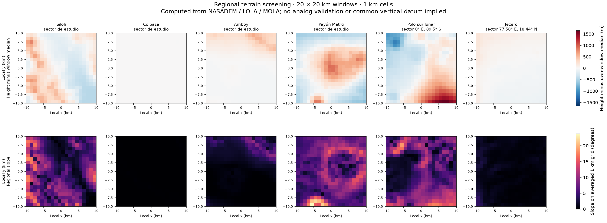

# Fichas científicas del análisis exploratorio

Persona 2 · 14 de noviembre de 2026. Generado mediante `processing/write_report.py` a partir de `data/processed/catalog.json`.

**Estado: indicadores calculados con datos reales; analogías sin validar y revisión científica independiente pendiente.**

Se describen cuadrados del equipo de 20 × 20 km. Las cifras no representan accidentes geográficos completos. Las diferencias candidato–referencia no son un ranking.

## Resumen a 1 km

| Ventana | Destino | Pendiente mediana (°) | Pendiente P90 (°) | Relieve P95–P5 (m) |
| --- | --- | ---: | ---: | ---: |
| Siloli — sector de estudio | Marte | 5.83 | 12.22 | 949.8 |
| Coipasa — sector de estudio | Marte | 0.00 | 0.13 | 5.8 |
| Amboy — sector de estudio | Luna | 0.76 | 4.48 | 398.7 |
| Payún Matrú — sector de estudio | Luna | 7.06 | 12.24 | 1174.3 |
| Polo sur lunar — sector 0° E, 89.5° S | Luna | 6.64 | 12.56 | 1663.0 |
| Jezero — sector 77.58° E, 18.44° N | Marte | 0.66 | 1.51 | 188.3 |

Los cuatro candidatos tienen 400/400 celdas finitas de altura y pendiente a 1 km. Esto incluye valores interpolados de los productos y no mide observaciones directas ni exactitud.

## Siloli — sector de estudio

- **Ubicación:** Bolivia, Potosí; centro del equipo -22.12° latitud, -67.88° longitud.
- **Destino y referencia:** Jezero — sector 77.58° E, 18.44° N.
- **Uso por investigar:** Evaluar el relieve regional como candidato para planificar reconocimiento y campañas geológicas.
- **Terreno/contexto:** No se atribuye composición mineral ni aridez medida. Falta una fuente geológica específica del polígono.
- **Novedad:** No evaluada mediante revisión bibliográfica exhaustiva.

### Evidencia calculada y sensibilidad

| Indicador | Candidato a 1 km | Referencia a 1 km | Diferencia | Candidato a 2 km |
| --- | ---: | ---: | ---: | ---: |
| Pendiente mediana (deg) | 5.83 | 0.66 | +5.17 | 4.30 |
| Pendiente P90 (deg) | 12.22 | 1.51 | +10.70 | 9.00 |
| Relieve P95–P5 (m) | 949.83 | 188.33 | +761.50 | 870.41 |

La tabla contrasta el relieve regional a las escalas indicadas. Las diferencias en signo o magnitud no determinan por sí solas la utilidad del sitio.

En esta selección, Siloli presenta pendientes y relieve mayores que la ventana de Jezero. No conviene describirlo como una reproducción de ese sector marciano. Puede mantenerse como candidato para investigar un objetivo diferente, una vez aportada evidencia geológica local.

### Límites específicos

- Ubicación nominal orientativa; el polígono define exactamente el sector analizado.
- La hipótesis geológica y ambiental del sector permanece sin validar.

### Fuentes y trazabilidad

- [NASADEM_HGT.001](https://www.earthdata.nasa.gov/data/catalog/lpcloud-nasadem-hgt-001).
- Fuente geológica específica del polígono: pendiente. NASADEM aporta elevación, no composición ni aridez.
- [Polígono terrestre](../data/processed/study-areas-earth.geojson) y [catálogo con productos, escalas, métodos y hashes](../data/processed/catalog.json).

## Coipasa — sector de estudio

- **Ubicación:** Bolivia, Oruro; centro del equipo -19.38° latitud, -68.12° longitud.
- **Destino y referencia:** Jezero — sector 77.58° E, 18.44° N.
- **Uso por investigar:** Examinar un sector del entorno de Coipasa como contraste de relieve para reconocimiento de cuencas.
- **Terreno/contexto:** NASA documenta el interés de los salares andinos para investigar ambientes marcianos. Esa evidencia regional no demuestra equivalencia química con Jezero ni con este polígono.
- **Novedad:** Análogo regional ya discutido en la literatura; no se afirma descubrimiento.

### Evidencia calculada y sensibilidad

| Indicador | Candidato a 1 km | Referencia a 1 km | Diferencia | Candidato a 2 km |
| --- | ---: | ---: | ---: | ---: |
| Pendiente mediana (deg) | 0.00 | 0.66 | -0.66 | 0.01 |
| Pendiente P90 (deg) | 0.13 | 1.51 | -1.38 | 0.07 |
| Relieve P95–P5 (m) | 5.79 | 188.33 | -182.54 | 5.64 |

La tabla contrasta el relieve regional a las escalas indicadas. Las diferencias en signo o magnitud no determinan por sí solas la utilidad del sitio.

La ventana de Coipasa es mucho más plana que la de Jezero en el modelo agregado. El interés regional de los salares para estudios marcianos no convierte a este cuadrado en equivalente de Jezero. La pendiente mediana cero requiere considerar aplanamientos y limitaciones de los DEM sobre salares.

### Límites específicos

- No se midieron sales, arcillas, salmuera, estacionalidad ni capacidad portante.
- Los DEM de superficies muy planas o agua pueden contener aplanamientos y errores comparables al relieve.

### Fuentes y trazabilidad

- [NASADEM_HGT.001](https://www.earthdata.nasa.gov/data/catalog/lpcloud-nasadem-hgt-001).
- [Bolivian Salt Flats](https://science.nasa.gov/earth/earth-observatory/bolivian-salt-flats-151813/).
- [Polígono terrestre](../data/processed/study-areas-earth.geojson) y [catálogo con productos, escalas, métodos y hashes](../data/processed/catalog.json).

## Amboy — sector de estudio

- **Ubicación:** Estados Unidos, California; centro del equipo 34.55° latitud, -115.78° longitud.
- **Destino y referencia:** Polo sur lunar — sector 0° E, 89.5° S.
- **Uso por investigar:** Evaluar el relieve de un campo volcánico y su entorno para preparar cartografía de campo.
- **Terreno/contexto:** BLM describe un cono de cenizas/escorias y coladas basálticas en Amboy. El área de análisis es mayor que el cono.
- **Novedad:** Sitio volcánico conocido; candidato de contraste, no descubrimiento.

### Evidencia calculada y sensibilidad

| Indicador | Candidato a 1 km | Referencia a 1 km | Diferencia | Candidato a 2 km |
| --- | ---: | ---: | ---: | ---: |
| Pendiente mediana (deg) | 0.76 | 6.64 | -5.87 | 0.63 |
| Pendiente P90 (deg) | 4.48 | 12.56 | -8.08 | 3.64 |
| Relieve P95–P5 (m) | 398.72 | 1663.01 | -1264.29 | 403.27 |

La tabla contrasta el relieve regional a las escalas indicadas. Las diferencias en signo o magnitud no determinan por sí solas la utilidad del sitio.

La ventana de Amboy tiene menores pendientes y relieve que la referencia polar lunar. El cono es menor que una celda y el cuadrado incluye otros terrenos. El contexto volcánico puede motivar estudios de campo, pero este cálculo no reproduce el relieve lunar ni su origen.

### Límites específicos

- El cono volcánico de Amboy no comparte origen de impacto con los cráteres lunares.
- A 1 km, el cono de ~457 m de diámetro descrito por BLM queda por debajo del tamaño de celda.

### Fuentes y trazabilidad

- [NASADEM_HGT.001](https://www.earthdata.nasa.gov/data/catalog/lpcloud-nasadem-hgt-001).
- [Amboy Crater National Natural Landmark](https://www.blm.gov/visit/amboy-crater-national-natural-landmark).
- [Polígono terrestre](../data/processed/study-areas-earth.geojson) y [catálogo con productos, escalas, métodos y hashes](../data/processed/catalog.json).

## Payún Matrú — sector de estudio

- **Ubicación:** Argentina, Mendoza; centro del equipo -36.422° latitud, -69.241° longitud.
- **Destino y referencia:** Polo sur lunar — sector 0° E, 89.5° S.
- **Uso por investigar:** Examinar un sector volcánico de mayor relieve para contrastar la preparación de reconocimiento regional.
- **Terreno/contexto:** Smithsonian GVP clasifica Payún Matrú como conjunto/campo volcánico con escudo y caldera. La analogía aquí solo evalúa relieve, no igualdad litológica.
- **Novedad:** Novedad como análogo no evaluada; sistema volcánico conocido.

### Evidencia calculada y sensibilidad

| Indicador | Candidato a 1 km | Referencia a 1 km | Diferencia | Candidato a 2 km |
| --- | ---: | ---: | ---: | ---: |
| Pendiente mediana (deg) | 7.06 | 6.64 | +0.42 | 6.99 |
| Pendiente P90 (deg) | 12.24 | 12.56 | -0.31 | 10.64 |
| Relieve P95–P5 (m) | 1174.35 | 1663.01 | -488.66 | 1139.12 |

La tabla contrasta el relieve regional a las escalas indicadas. Las diferencias en signo o magnitud no determinan por sí solas la utilidad del sitio.

En esta ventana, la pendiente mediana y P90 de Payún Matrú están próximas a las de la referencia lunar a 1 km, mientras que el relieve P95–P5 es menor. A 2 km cambia la relación entre las medianas: la coincidencia depende de la escala. Es una observación topográfica preliminar, sin equivalencia mineralógica ni validación de ensayo.

### Límites específicos

- Una caldera volcánica no equivale a un cráter de impacto.
- La pendiente regional no mide bloques, polvo, cohesión ni obstáculos a escala de rover.

### Fuentes y trazabilidad

- [NASADEM_HGT.001](https://www.earthdata.nasa.gov/data/catalog/lpcloud-nasadem-hgt-001).
- [Payún Matrú, volcano 357066](https://volcano.si.edu/volcano.cfm?vn=357066).
- [Polígono terrestre](../data/processed/study-areas-earth.geojson) y [catálogo con productos, escalas, métodos y hashes](../data/processed/catalog.json).

## Referencias planetarias

### Polo sur lunar — sector 0° E, 89.5° S

Ventana del equipo en la región polar de interés para exploración; no es un polígono oficial de aterrizaje o base.

Ventana de 20 × 20 km con proyección local y cuerpo explícitos en el catálogo. Los centros no se declaran coordenadas oficiales de instalación de base ni de aterrizaje.

### Jezero — sector 77.58° E, 18.44° N

Ventana del equipo dentro del entorno de Jezero para contrastar relieve de una región de exploración. El centro no se declara punto exacto de aterrizaje.

Ventana de 20 × 20 km con proyección local y cuerpo explícitos en el catálogo. Los centros no se declaran coordenadas oficiales de instalación de base ni de aterrizaje.

## Complemento ambiental evaluado

Se mantiene fuera del primer cálculo: MOD11A2 aporta temperatura de superficie terrestre promediada en ocho días; Diviner tiene productos térmicos lunares con muestreo y definiciones diferentes. Sin armonizar magnitud, estadístico, hora local, calidad y periodo, una distancia térmica sería engañosa. No se descargaron ni calcularon esos productos.

Sentinel podría aportar contexto óptico y cobertura del suelo. No se utiliza una imagen o baja vegetación como prueba suficiente de aridez o composición. Radar, mineralogía, hielo y biología siguen fuera de los indicadores calculados.

## Entrega y revisión pendiente

- D1: cuatro ventanas terrestres y dos referencias delimitadas; hipótesis explícitas. Novedad científica y representatividad espacial no demostradas.
- D2: datos reales obtenidos; NASADEM sustituye a SRTMGL1 y se registra esa diferencia. Metadatos y procedencia conservados.
- D3: pipeline reproducible y modo offline con entradas locales.
- D4: indicadores, sensibilidad y control visual generados. Inspección externa en QGIS y revisión científica independiente pendientes.
- D5: fichas, metodología y bibliografía disponibles.
- D6: complemento ambiental evaluado y pospuesto por falta de compatibilidad validada; sin variables inventadas.

La figura usa la misma escala de color entre ventanas. Alturas relativas a la mediana de cada ventana: no implica un datum vertical compartido. Véase [la metodología](metodologia-cientifica.md) para los límites.
